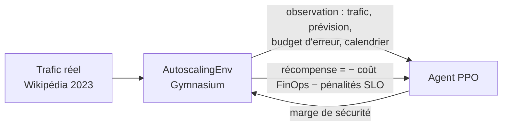
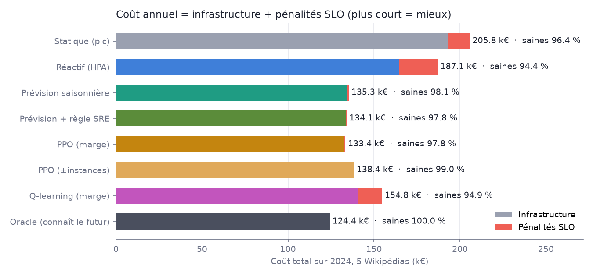
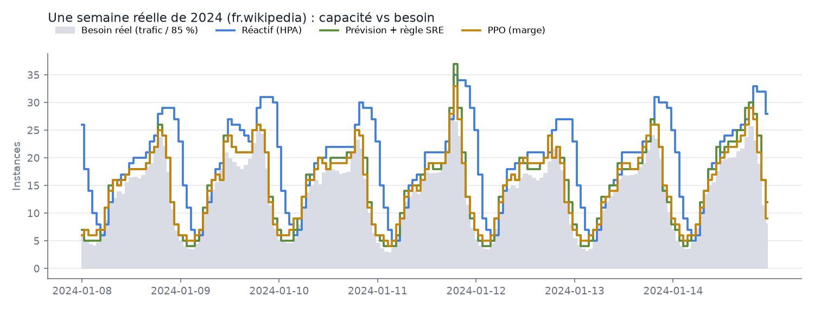
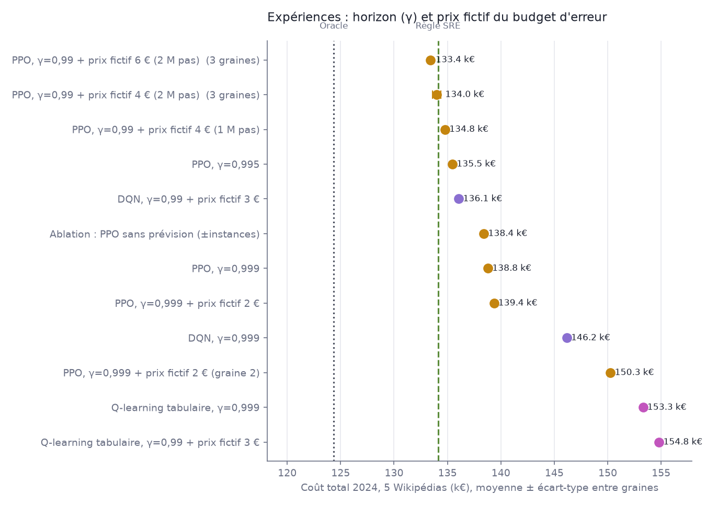
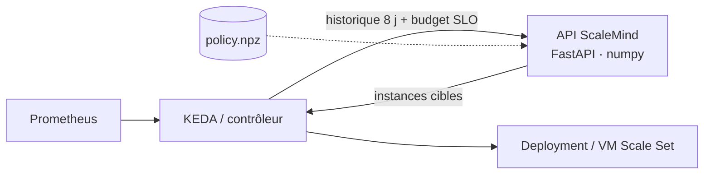

# ScaleMind

**Autoscaling cloud par reinforcement learning, sous budget d'erreur SLO, sur le vrai trafic de Wikipédia.**


**[▶ Voir la démo interactive](https://mikathedark.github.io/scalemind/)**

> *English summary* — A PPO agent learns how much safety margin to provision on top of a seasonal
> forecast, so that a cloud cluster serving real hourly Wikipedia traffic (5 languages, 2023 → 2024)
> spends as little as possible while respecting a 97 % monthly SLO error budget. Trained on 2023,
> evaluated on all of 2024, compared against Kubernetes-HPA-style, forecasting and SRE burn-rate
> baselines, and served through a torch-free FastAPI microservice.

## En bref

| | Coût 2024 (5 Wikipédias) | vs règle SRE | Heures hors budget |
|---|---:|---:|---:|
| Provisionnement statique | 205 770 € | +53,4 % | 828 |
| Kubernetes HPA (réactif) | 187 115 € | +39,5 % | 1 487 |
| Prévision + règle SRE (baseline experte) | 134 125 € | — | 29 |
| **PPO (marge apprise)** | **133 388 €** | **−0,5 %** | **21** |
| Oracle (connaît le futur) | 124 351 € | −7,3 % | 0 |

L'agent PPO coûte **29 % de moins qu'un autoscaler réactif de type HPA**, et il **bat la meilleure règle
écrite à la main sur les 3 graines d'entraînement** (133 407 € ± 92 en moyenne), tout en consommant moins de budget d'erreur.

## Expliqué simplement

Imaginez un marchand de glaces qui doit décider, chaque heure, combien de vendeurs mettre derrière le comptoir.

- Trop de vendeurs, et il paie des gens qui attendent sans rien faire.
- Pas assez, et la file d'attente déborde : les clients sont mécontents.
- Un vendeur appelé met une heure à arriver. Il faut donc **deviner à l'avance** l'affluence de l'heure suivante.
- Le patron tolère quelques heures de file d'attente par mois (le « budget d'erreur »). Une fois ce budget
  épuisé, chaque heure de file coûte une grosse amende. Bien gérer ce budget, c'est savoir **quand prendre des risques** :
  tôt dans le mois, avec du budget en réserve, on peut tourner serré ; en fin de mois, budget presque vide, on assure.

Ici, les vendeurs sont des **serveurs cloud** et les clients sont les **vraies visites de Wikipédia**, heure par heure.
Personne n'explique la stratégie à l'agent : il joue des milliers de mois simulés sur 2023, reçoit des points selon
ce qu'il dépense, et s'améliore tout seul. C'est le reinforcement learning. On lui fait ensuite passer l'examen
sur 2024, une année qu'il n'a jamais vue.

## Le problème

Toutes les heures, un autoscaler décide combien de serveurs faire tourner. Il arbitre entre deux coûts :

- **FinOps** : chaque serveur coûte à l'heure, même s'il ne sert à rien.
- **SRE** : trop peu de serveurs dégradent la latence. Le contrat de service (SLO) autorise au plus
  **3 % d'heures dégradées par mois** : c'est le *budget d'erreur*, environ 21 heures. Une fois ce
  budget épuisé, chaque heure dégradée coûte cher (avoirs clients, image de marque).

Deux difficultés rendent le problème intéressant :

1. **Le démarrage à froid** : un serveur ajouté n'est prêt que l'heure suivante. Il faut donc anticiper
   le trafic, et un autoscaler réactif comme le HPA de Kubernetes a toujours une heure de retard.
2. **Le budget d'erreur rend la décision séquentielle** : prendre un risque aujourd'hui consomme un
   budget dont on aura peut-être besoin dans deux semaines. La bonne marge dépend de l'état du budget
   et du temps restant. C'est un problème de *credit assignment* à long terme, le terrain naturel du RL.

## Les données

- **Source** : [Wikimedia Pageviews API](https://wikimedia.org/api/rest_v1/), pages vues horaires, données **CC0**.
- **Séries** : Wikipédia fr, en, de, es et ja, du 1er janvier 2023 au 31 décembre 2024, soit 5 × 17 544 heures.
- **Mise à l'échelle** : le trafic est converti en « instances nécessaires », en calibrant la capacité
  d'une instance sur le 99e centile de **2023**. Même échelle pour 2024, sans fuite d'information.
- **Split temporel strict** : entraînement et réglage des baselines sur 2023, évaluation sur toute l'année 2024.

Les CSV sont versionnés dans `data/raw/`. `python -m scalemind.data --force` les re-télécharge.

## La modélisation

Le problème est formulé comme un processus de décision markovien, dans un environnement [Gymnasium](https://gymnasium.farama.org/) (`scalemind/env.py`) :

| | |
|---|---|
| **Pas de temps** | 1 heure. La décision prise en fin d'heure *t* fixe la capacité de l'heure *t+1*. |
| **Observation (16)** | Demande récente (t, t-1, t-2, t-24), même heure hier et la semaine dernière, prévision saisonnière, instances actuelles, erreur de la dernière prévision, volatilité des erreurs sur 24 h, **budget d'erreur restant**, **avancement dans la fenêtre de 30 jours**, heure et jour (encodage sin/cos). |
| **Action (9)** | La marge de sécurité au-dessus de la prévision : −10 %, −5 %, 0, +3 %, +6 %, +10 %, +15 %, +25 %, +40 %. Une variante « brute » (±1, 2, 4 ou 8 instances) sert d'ablation. |
| **Coût horaire** | instances × 0,20 € + démarrages × 0,05 € + 15 € par heure dégradée **hors budget** + 1 € par instance-heure de demande non servie. |
| **Récompense** | − coût horaire (mis à l'échelle), plus un « prix fictif » de 6 € par heure dégradée dans le budget, à l'entraînement seulement. |



## Les approches comparées

| Politique | Description |
|---|---|
| Statique (pic) | Provisionné pour le pic de 2023. Zéro risque, beaucoup de gaspillage. |
| Réactif (HPA) | Comme le Horizontal Pod Autoscaler de Kubernetes : vise une utilisation cible sur la charge actuelle, avec stabilisation à la baisse. |
| Prévision saisonnière | « Même heure hier × tendance du jour », avec une marge fixe. |
| Prévision + règle SRE | Marge basse tant que le budget se consomme moins vite que le temps ne passe, marge haute sinon (*burn rate*). **La baseline à battre.** |
| Q-learning (marge) | Q-learning tabulaire **codé à la main en numpy** (1 800 états discrets), pour comprendre l'algorithme sans boîte noire. |
| DQN / PPO (marge) | Réseaux de neurones ([stable-baselines3](https://stable-baselines3.readthedocs.io/)) qui choisissent la marge à partir de l'observation complète. |
| PPO (±instances) | Ablation : PPO sans structure de prévision, qui ajoute ou retire des instances directement. |
| Oracle | Connaît le trafic de l'heure suivante. Ce n'est pas une stratégie, c'est la borne basse du coût. |

Toutes les baselines sont **réglées par recherche sur grille sur 2023**, pour affronter leur meilleure version.

## Résultats (2024, 5 Wikipédias, 43 920 heures)

| Politique | Coût total | Infra | Pénalités SLO | Heures saines | H hors budget | Utilisation |
|---|---:|---:|---:|---:|---:|---:|
| Statique (pic) | 205 770 € | 193 228 € | 12 542 € | 96,4 % | 828 | 51 % |
| Réactif (HPA) | 187 115 € | 164 373 € | 22 742 € | 94,4 % | 1 487 | 61 % |
| Prévision saisonnière | 135 341 € | 134 452 € | 889 € | 98,1 % | 44 | 75 % |
| Prévision + règle SRE | 134 125 € | 133 456 € | 669 € | 97,8 % | 29 | 76 % |
| Q-learning tabulaire (marge) | 154 804 € | 140 420 € | 14 384 € | 94,9 % | 934 | 72 % |
| PPO sans prévision (±instances) | 138 407 € | 138 236 € | 171 € | 99,0 % | 0 | 73 % |
| **PPO (marge apprise)** | **133 388 €** | 132 731 € | 657 € | **97,8 %** | **21** | **76 %** |
| Oracle (borne basse) | 124 351 € | 124 286 € | 64 € | 100 % | 0 | 81 % |

Par Wikipédia, PPO bat la règle SRE sur fr (−1,0 %), de (−2,1 %), en et ja, et perd de 31 € sur es.
Le détail complet est dans `results/metrics.json`.





### Lecture honnête

- **Le gros gain vient de l'anticipation.** Passer d'un autoscaler réactif à une prévision saisonnière
  divise presque par 1,4 le coût annuel. C'est le démarrage à froid qui pénalise le réactif.
- **Le RL apporte la gestion du budget d'erreur.** Face à une règle SRE déjà réglée, PPO gagne 0,5 %,
  soit environ 7 % de l'écart restant avec l'oracle. Le gain est modeste mais **reproductible** : 3 graines sur 3,
  avec un écart-type de 92 €.
- **La structure compte plus que l'algorithme.** Le même PPO qui ajoute ou retire des instances « à la main »,
  sans s'appuyer sur la prévision, coûte 3,8 % de plus. Le Q-learning tabulaire, limité à 1 800 états discrets,
  ne suffit pas.
- **Le facteur décisif, c'est le *credit assignment*.** Avec un horizon trop court, PPO consomme tout son budget
  en début de mois puis paie des pénalités, et un horizon très long (γ = 0,999) apprend mal. La solution retenue est
  un « prix fictif » de 6 € par heure dégradée dans le budget, utilisé seulement à l'entraînement. Il rend
  immédiat un coût qui, sinon, n'apparaît que des semaines plus tard. L'évaluation se fait toujours sur les vrais coûts.

Toutes les expériences sont reproductibles avec `experiments/sweep.py`, et leurs résultats sont dans `results/sweep.jsonl`.

## Architecture de production

L'API de recommandation (`scalemind/serve.py`) est prête à être conteneurisée. Elle n'embarque pas PyTorch : la politique est exportée en poids numpy, et l'inférence prend moins d'une milliseconde. Des garde-fous la complètent, avec repli sur la règle SRE si le modèle est absent ou incompatible. Le détail des choix, le contrat d'API et le cycle de vie du modèle sont dans **[docs/architecture.md](docs/architecture.md)**.



## Lancer le projet

```bash
python -m venv .venv && source .venv/bin/activate      # Windows : .venv\Scripts\activate
pip install -e ".[rl,serve,dev]"

python -m scalemind.data                                 # (optionnel) re-télécharge le trafic
python -m scalemind.train --steps 500000                 # entraînement rapide de bout en bout (1 graine)

# résultats publiés : balayage multi-graines puis rapport
python experiments/sweep.py '{"name":"final_sh6_s0","algo":"ppo","gamma":0.99,"lam":0.95,"shadow":6.0,"steps":2000000,"seed":0}'
python -m scalemind.report                               # tableau, graphiques, rejeu web, policy.npz
pytest -q                                                # 18 tests

uvicorn scalemind.serve:app --port 8000                  # API : http://localhost:8000/docs
docker build -t scalemind-api . && docker run -p 8000:8000 scalemind-api
```

**Visualisation** : [en ligne ici](https://mikathedark.github.io/scalemind/), ou ouvrez `web/index.html` dans un navigateur. C'est un rejeu en pixel art de 8 semaines de 2024 : deux salles serveurs face à face, coûts et budget d'erreur en direct, et un mode « Jouer l'autoscaler » pour affronter l'agent.

## Structure

```
scalemind/
  data.py        ingestion Wikimedia, cache, split temporel
  env.py         environnement Gymnasium (coûts, démarrage à froid, budget d'erreur)
  policies.py    baselines : statique, HPA, prévision, règle SRE, oracle
  qlearning.py   Q-learning tabulaire écrit à la main
  train.py       réglage des baselines, entraînement PPO/DQN, évaluation, exports
  report.py      rapport final à partir des modèles du balayage
  evaluate.py    rejeu d'une politique sur l'année de test
  serve.py       API FastAPI + export numpy de la politique
  plots.py       graphiques du README
tests/           18 tests (environnement, politiques, API, parité entraînement/service)
experiments/     balayage d'hyperparamètres (horizon γ, prix fictif du budget, graines)
web/             visualisation interactive (HTML/JS, sans dépendance)
docs/            architecture de production
```

## Ce que ce projet m'a appris

1. **Commencer par des baselines fortes et réglées.** La première version du projet mettait en scène un
   agent RL contre des règles naïves, et il « gagnait ». Face à une prévision saisonnière bien réglée, il ne
   gagnait plus. Il a fallu reformuler le problème (budget d'erreur SLO) pour que la décision soit vraiment
   séquentielle, c'est-à-dire là où le RL a un avantage structurel.
2. **Le RL n'est pas une boîte magique.** La combinaison « prévision classique + RL pour la marge » bat le RL
   seul. En production, c'est aussi plus explicable et plus sûr.
3. **Façonner la récompense sans tricher.** Le prix fictif du budget modifie l'objectif d'entraînement, pas la
   mesure. Les chiffres publiés sont les vrais coûts.
4. **Penser au service dès le départ.** Même code d'observation pour l'entraînement et l'API (testé), export
   du réseau en numpy pour une image Docker sans PyTorch, garde-fous et repli sur une règle connue.

## Limites et pistes

- Granularité horaire et un seul type d'instance. Pistes : trafic à la minute, mix on-demand/spot appris par l'agent.
- Le trafic de Wikipédia est régulier, ce qui rend la prévision déjà très bonne. Un trafic plus chaotique (e-commerce, soldes) mettrait davantage en valeur une marge apprise.
- 3 graines pour l'agent principal, mais une seule pour les autres configurations du balayage.
