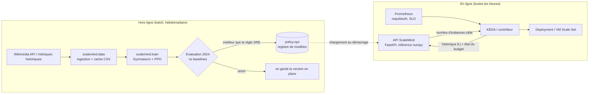

# Architecture : de l'expérience au service de production

Ce document décrit comment ScaleMind passerait d'un notebook de recherche à un composant
d'autoscaling en production. La partie « service » est implémentée dans ce dépôt (`scalemind/serve.py`,
`Dockerfile`). Les briques d'infrastructure (Prometheus, KEDA, registre de modèles) sont décrites
comme cible, et ne sont pas déployées ici.

## Vue d'ensemble



## Choix de conception

| Décision | Pourquoi | Alternative écartée |
|---|---|---|
| **Entraînement PyTorch, inférence numpy** | La politique est un petit MLP (2 × 64 neurones). L'exporter en `.npz` évite d'embarquer PyTorch (≈ 800 Mo) dans l'image de service : image légère, démarrage rapide, inférence < 1 ms. | Servir le modèle stable-baselines3 tel quel |
| **Même code d'observation à l'entraînement et en production** | `AutoscalingEnv.from_history` reconstruit l'observation exacte à partir de l'historique brut. Un test garantit l'égalité (`test_serving_rebuilds_exactly_the_training_observation`). C'est la cause n° 1 de dégradation silencieuse des modèles en production. | Réécrire le calcul des features côté API |
| **L'API recommande, elle n'agit pas** | Le contrôleur reste maître : on peut déployer en *shadow mode* (on journalise la recommandation sans l'appliquer), comparer au comportement actuel, puis basculer. | Donner à l'agent un accès direct à l'API Kubernetes |
| **Garde-fous déterministes** | Bornes min/max, historique incomplet → on garde la taille actuelle, modèle absent ou incompatible → repli sur la règle « prévision + budget SRE ». Le RL ne peut jamais faire pire qu'une règle connue en cas de panne. | Faire confiance au modèle seul |
| **RL hybride (prévision + marge apprise)** | La prévision saisonnière fait déjà l'essentiel. L'agent apprend la seule chose difficile : combien de marge prendre selon l'heure, les erreurs récentes et le budget d'erreur restant. Apprentissage plus rapide, décisions plus explicables. | RL « brut » qui ajoute/retire des instances (gardé comme ablation) |
| **Split temporel strict** | Entraînement sur 2023, évaluation sur 2024, même mise à l'échelle calculée sur 2023 : aucune fuite d'information du futur. | Split aléatoire des heures (fuite via la saisonnalité) |

## Contrat d'API

`POST /v1/recommend`

```json
{
  "load_history": [812340, 790112, "... au moins 193 valeurs horaires"],
  "capacity_per_instance": 40000,
  "current_instances": 14,
  "last_hour": "2024-03-12T09:00:00",
  "degraded_hours_in_window": 6,
  "hours_into_window": 250
}
```

```json
{
  "target_instances": 16,
  "delta": 2,
  "policy": "PPO (marge)",
  "fallback": false,
  "reason": "politique RL",
  "latency_ms": 0.41
}
```

`GET /health` : état du service et du modèle chargé (utilisé par le `HEALTHCHECK` Docker et une *readiness probe* Kubernetes).

## Déploiement cible

- **Kubernetes (AKS, EKS, GKE)** : l'API tourne en `Deployment` à 2 réplicas derrière un `Service`. Un
  [KEDA](https://keda.sh) *external scaler*, ou un petit CronJob horaire, interroge l'API et applique
  la cible au `Deployment` surveillé. La politique vit dans l'image, versionnée par tag.
- **VM Scale Sets / Auto Scaling Groups** : une fonction planifiée (Azure Functions, AWS Lambda)
  lit les métriques, appelle l'API et règle la capacité voulue (*desired capacity*).
- **Observabilité** : chaque recommandation est journalisée (entrée, sortie, repli, latence).
  On suit le coût réel, les heures dégradées et le budget d'erreur restant sur un tableau de bord.
  Une alerte se déclenche si le taux de repli dépasse 1 %.

## Cycle de vie du modèle

1. Ré-entraînement hebdomadaire sur les 12 derniers mois (`python -m scalemind.train`).
2. **Porte de qualité** : le nouveau modèle n'est publié que s'il bat la règle SRE *et* le modèle en
   place sur une période récente jamais vue.
3. Déploiement en *shadow mode* pendant une semaine, puis en canary sur un service, puis généralisé.
4. Retour arrière immédiat : repasser au tag d'image précédent. La règle SRE reste toujours disponible.

## Limites connues

- Granularité horaire : un vrai autoscaler réagit à la minute. Le même environnement s'applique
  à des séries à la minute, en adaptant la fenêtre d'historique.
- Un seul type d'instance, sans instances spot ni réservées. C'est une extension naturelle de
  l'espace d'actions, par exemple un mix on-demand/spot appris.
- Le trafic de Wikipédia est très régulier. Sur un trafic plus chaotique (e-commerce, promotions),
  la valeur ajoutée d'une marge apprise devrait être plus grande. C'est à vérifier.
